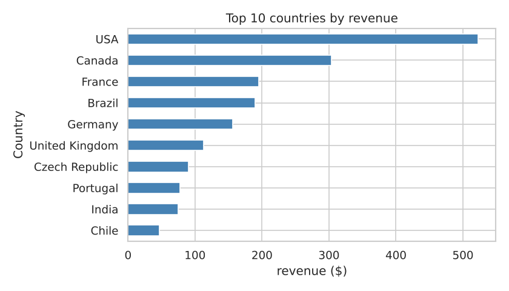

# Music Store SQL Case Study

Eight business questions for a digital music store, answered with SQL on the Chinook sample database (SQLite). Each query is a standalone `.sql` file; the notebook runs them and explains the results.



## Data

[Chinook](https://github.com/lerocha/chinook-database): 11 tables covering customers, employees, invoices, invoice lines, tracks, albums, artists, genres and media types. 59 customers in 24 countries and 412 invoices over five years. Chinook is a teaching dataset, so its sales are more regular than real data. The file is included in `data/`.

## Questions and SQL techniques

| # | Question | Techniques |
|---|---|---|
| 1 | Which countries bring in the most revenue per customer? | Joins, aggregates, scalar subquery |
| 2 | Is revenue growing month to month? | CTE, `LAG`, 3-month moving `AVG` window |
| 3 | What is the top genre in each country? | Two CTEs, `RANK() OVER (PARTITION BY ...)` |
| 4 | Which customers are champions or at risk of leaving? | RFM scoring with `NTILE(4)`, `CASE` segments, `julianday` |
| 5 | How do sales reps compare? | `SUM() OVER ()` for share of total, `RANK` |
| 6 | How much of the catalog never sells? | `LEFT JOIN` anti-join, conditional aggregation |
| 7 | Do customers buy albums or single tracks? | CTEs comparing invoice contents to album size |
| 8 | Which artists drive revenue? | Running `SUM` window for a Pareto curve |

## Findings

- **Revenue follows customer count.** USA and Canada bring in 36% of revenue, but revenue per customer is $38–40 in nearly every country.
- **No growth.** Monthly revenue is flat at about $37–38 for five years, so new customer acquisition is the main lever.
- **Rock leads in 23 of 24 countries.** Sweden is the exception (Latin).
- **14 high-value customers are lapsing.** The RFM "At risk" segment holds 25% of lifetime revenue and is the first target for a win-back campaign.
- **About 43% of the catalog has never sold.**
- **99.5% of purchases are single tracks**, not full albums.
- **Long tail of artists.** The top 5 artists bring in 22% of revenue; the top 15 bring in 39%.

## Files

| Path | Contents |
|---|---|
| `queries/01_…08_*.sql` | One query per business question |
| `music_store_sql_analysis.ipynb` | Runs every query, with charts and interpretation |
| `data/chinook.sqlite` | The database |

## How to run

```bash
git clone https://github.com/mehtesham13/music-store-sql-case-study.git
cd music-store-sql-case-study
sqlite3 data/chinook.sqlite < queries/04_customer_rfm_segments.sql   # any single query
pip install pandas matplotlib seaborn jupyter
jupyter notebook music_store_sql_analysis.ipynb
```

Author: Muhammad Ehtesham · [LinkedIn](https://www.linkedin.com/in/muhammad-ehtesham-dsa)
